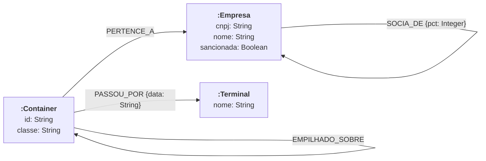
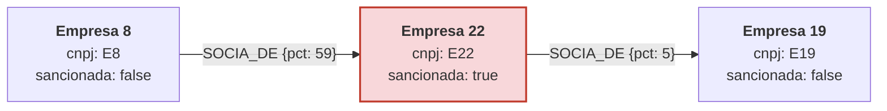

# Prova DBNoSQL 2 Bimestre

| | |
|---|---|
| **Disciplina** | Banco de Dados NoSQL - Engenharia de Software |
| **Professor** | Leonardo Rocha |
| **Aluno** | Andrey Araújo Borghi |
| **RA** | 26006549-2 |

## Parâmetros da prova

| Parâmetro | Valor |
|---|---|
| CLASSE_ALVO | Refrigerado |
| TERMINAL_ALVO | T4 |
| DATA_CORTE | 2026-04-01 |
| INCIDENTE | -25.4580 -48.4730 |
| EMPRESA_SANCIONADA | E22 |
| BASE_DA_PILHA | K28 |
| **Código de Autenticidade** | LP-260065492-20049-80461 |


# Parte A — Auditoria e Indexação no MongoDB (30 pontos)

## A1. Painel do pátio (10 pontos)

### a) Sem nenhum índice criado, rode .explain("executionStats") e registre stage, totalDocsExamined, totalKeysExamined, nReturned e executionTimeMillis.

- plano: 'SORT <- COLLSCAN',
- totalDocsExamined: 400000,
- totalKeysExamined: 0,
- nReturned: 20,
- executionTimeMillis: 1398

### b) Crie o índice "na ordem do filtro" { terminal: 1, classe: 1, ts: 1, peso_kg: -1 } e registre as mesmas métricas.

```javascript
db.movimentacoes.createIndex({ terminal: 1, classe: 1, ts: 1, peso_kg: -1 })
```

- plano: 'FETCH <- SORT <- IXSCAN',
- totalDocsExamined: 20,
- totalKeysExamined: 14079,
- nReturned: 20,
- executionTimeMillis: 19


### c) Remova o índice anterior e crie o índice projetado pela regra ESR. Registre as métricas novamente.

```javascript
db.movimentacoes.dropIndex({ terminal: 1, classe: 1, ts: 1, peso_kg: -1 })
db.movimentacoes.createIndex({ terminal: 1, classe: 1, peso_kg: -1, ts: 1 })
```

-  plano: 'LIMIT <- FETCH <- IXSCAN',
- totalDocsExamined: 20,
- totalKeysExamined: 30,
- nReturned: 20,
- executionTimeMillis: 3


### d) Monte uma tabela comparando a), b) e c) e explique a diferença entre b) e c) com base no funcionamento da B-Tree e do mecanismo de ordenação.

| Métrica | a) sem índice | b) ordem do filtro | c) ESR |
|---|---|---|---|
| Stage | SORT <- COLLSCAN | FETCH <- SORT <- IXSCAN | LIMIT <- FETCH <- IXSCAN |
| totalDocsExamined | 400000 | 20 | 20 |
| totalKeysExamined | 0 | 14079 | 30 |
| nReturned | 20 | 20 | 20 |
| executionTimeMillis | 1398 | 19 | 3 |
| SORT em memória | sim | sim | não |

**B-Tree.** O índice composto ordena as chaves campo a campo, na ordem declarada, ai cada campo só fica ordenado entre chaves que têm os campos anteriores iguais

**b) `{ terminal, classe, ts, peso_kg }`.** Dentro de T4 + Refrigerado, as chaves estão ordenadas por ts, que é praticamente único. Por isso o `peso_kg` fica fora de ordem. O IXSCAN precisa ler todas chaves do range, e um SORT bloqueante em memória escolhe os 20 mais pesados. Como `peso_kg` está na chave, o FETCH busca só os 20 documentos finais.

**c) `{ terminal, classe, peso_kg: -1, ts }`.** Dentro de T4 + Refrigerado, as chaves já estão em ordem decrescente de peso, então não há SORT. O `ts` é filtrado na própria chave (10 chaves descartadas) e o LIMIT para a varredura no 20 resultado. Resultado: 30 chaves em vez de + de14mil e 3 ms em vez de 19 ms.

## A2. Incidente no pátio (7 pontos)

O Google Maps entrega as coordenadas como `lat, lon` (`-25.4580, -48.4730`). O GeoJSON exige `[longitude, latitude]`, então o ponto do incidente é `[-48.4730, -25.4580]`.

```javascript
db.movimentacoes.find({
  posicao: {
    $near: {
      $geometry: { type: "Point", coordinates: [-48.4730, -25.4580] },
      $maxDistance: 300
    }
  }
}).limit(10)
```

### 1) Antes do índice

`ERRO: error enumerating plans for query: ns=logiporto.movimentacoes limit=10Tree: GEONEAR  field=posicao maxdist=300 isNearSphere=0
Sort: {}
Proj: {}
 planner returned error :: caused by :: unable to find index for $geoNear query`

O `$near` precisa de um índice geoespacial e sem ele, o MongoDB não consegue devolver os documentos ordenados por distância e recusa a consulta.

### 2) Indice criado

```javascript
db.movimentacoes.createIndex({ posicao: "2dsphere" })
```

O índice certo é o `2dsphere`, porque `posicao` é um GeoJSON point e a distância é calculada em metros sobre a Terra.

### 3) Latidude/long

documentos retornados: 0

Com as coordenadas na ordem do Google Maps, `[-25.4580, -48.4730]`, a consulta retorna 0 documentos e não dá errO MongoDB lê esse par como longitude -25.458 e latitude -48.473, que é um ponto válido.

### 4) Resultado (ordenado por proximidade)

| # | container | tipo | terminal | distância |
|---|---|---|---|---|
| 1 | CTN02024 | gate_out | T5 | 3,0 m |
| 2 | CTN03171 | inspecao | T4 | 5,2 m |
| 3 | CTN30557 | gate_in | T3 | 6,8 m |
| 4 | CTN01448 | inspecao | T4 | 7,0 m |
| 5 | CTN37504 | descarga | T3 | 9,0 m |
| 6 | CTN34945 | gate_in | T5 | 10,5 m |
| 7 | CTN01307 | carga | T3 | 12,2 m |
| 8 | CTN54381 | descarga | T5 | 12,3 m |
| 9 | CTN42498 | carga | T3 | 12,7 m |
| 10 | CTN33713 | descarga | T2 | 14,7 m |

### 5) explain("executionStats")

- Stage: LIMIT <- GEO_NEAR_2DSPHERE <- (2x FETCH <- IXSCAN)
- totalDocsExamined: 89
- totalKeysExamined: 125
- nReturned: 10
- executionTimeMillis: 7

### Etapas do plano

- **posicao_2dsphere:** o 2dsphere guarda cada ponto como células S2, uma grade que divide a esfera. Em cada anel de busca, o IXSCAN lê só as chaves das células que cobrem aquele anel: 28 chaves no 1 anel e 97 no 2.
- **FETCH:** as células são aproximadas, então é preciso carregar o documento para ter o ponto exato, foram 12 documentos no 1 anel e 77 no 2, total 89.
- **GEO_NEAR_2DSPHERE:** busca em aneis crescentes a partir do incidente, O anel de 0 a 13,3 m entregou 9 documentos e o de 13,3 a 39,9 m entregou o decimo. Em cada anel ele calcula a distância exata, descarta o que está fora e entrega em ordem crescente de distância. É daí que vem o "já ordenado por proximidade", sem estágio SORT. No 2 anel faltava só 1 resultado, mas ele precisou examinar os 77 candidatos para garantir que entregava o mais próximo.
- **LIMIT:** encerra a busca no 10º resultado. Por isso, mesmo com raio de 300 m, a busca não passou de 40 m.

## A3. O TTL que não apaga (6 pontos)

### Motivo

O campo `registrado_em` foi gravado como string, e não como Date do BSON; O índice TTL existe, mas só apaga documentos cujo campo indexado é do tipo Date.

### Comprovação

```javascript
db.alertas.aggregate([
  { $group: { _id: { $type: "$registrado_em" }, total: { $sum: 1 } } }
])
```

Os 100000 alertas têm registrado_em como string. Destes, + de 99000 já passaram dos 30 dias e continuam no banco.


Script: [mongo/A3.js](mongo/A3.js) | Saída: [mongo/A3_saida.txt](mongo/A3_saida.txt)

### Causa raiz

O TTL monitor é uma thread do mongod que roda a cada 60 segundos para cada índice TTL, ele apaga os documentos cujo valor indexado é uma Date e eele busca no índice so a faixa de chaves do tipo Date, como o MongoDB ordena as chaves primeiro pelo tipo BSON, as chaves strings ficam em outra faixa da b-tree e nunca entram nessa busca

### Comando de índice correto

```javascript
db.alertas.createIndex(
  { registrado_em: 1 },
  { expireAfterSeconds: 2592000 }   // 30 dias = 30x24x60x60
)
```

### Como deve gravar os novos alertas

registrado_em deve ser gravado como Date (BSON), e nunca como texto:

```javascript
db.alertas.insertOne({ sensor: "S1", nivel: "critico", registrado_em: new Date().toISOString() })

db.alertas.insertOne({ sensor: "S1", nivel: "critico", registrado_em: new Date() })
```

## A4. Consulta coberta (7 pontos)

### Índice criado

```javascript
db.movimentacoes.createIndex({ tipo: 1, terminal: 1, container: 1 })
```

- tipo e terminal: campos de igualdade do filtro
- container: único campo da projeção, no fim da chave. Assim o IXSCAN já tem o valor que precisa devolver.

### 1) Projeção `{ _id: 0, container: 1 }`

```javascript
db.movimentacoes.find(
  { tipo: "inspecao", terminal: "T4" },
  { _id: 0, container: 1 }
).explain("executionStats")
```

- indice: 'tipo_1_terminal_1_container_1',
- stage: 'PROJECTION_COVERED <- IXSCAN',
- totalDocsExamined: 0,
- totalKeysExamined: 16124,
- nReturned: 16124,
- executionTimeMillis: 18

### 2) Sem `_id: 0`: projeção `{ container: 1 }`

```javascript
db.movimentacoes.find(
  { tipo: "inspecao", terminal: "T4" },
  { container: 1 }
).explain("executionStats")
```

- indice: 'tipo_1_terminal_1_container_1',
- stage: 'PROJECTION_SIMPLE <- FETCH <- IXSCAN',
- totalDocsExamined: 16124,
- totalKeysExamined: 16124,
- nReturned: 16124,
- executionTimeMillis: 38

Script: [mongo/A4.js](mongo/A4.js) | Saída: [mongo/A4_saida.txt](mongo/A4_saida.txt)

### O que muda e porque

| | 1) `{ _id: 0, container: 1 }` | 2) `{ container: 1 }` |
|---|---|---|
| Stage | PROJECTION_COVERED <- IXSCAN | PROJECTION_SIMPLE <- FETCH <- IXSCAN |
| totalDocsExamined | 0 | 16124 |
| totalKeysExamined | 16124 | 16124 |
| executionTimeMillis | 18 | 38 |

No find, o _id vem na projeção por padrão, a menos que seja excluído explicitamente. Então `{ container: 1 }` na prática pede `{ _id: 1, container: 1 }`. O `_id` não está no índice `{ tipo, terminal, container }`, e o índice sozinho deixa de ter todos os campos do resultado. Para cada chave encontrada pelo IXSCAN, o estágio FETCH precisa ler o documento (16124 leituras) só para pegar o `_id`


# Parte B — Aggregation Pipeline (30 pontos)

## B1. Relatório gerencial (8 pontos)

### Pipeline

```javascript
db.movimentacoes.aggregate([
  { $match: { classe: "Refrigerado", ts: { $gte: ISODate("2026-04-01T00:00:00Z") } } },
  { $group: {
      _id: "$terminal",
      total_movimentacoes: { $sum: 1 },
      peso_total: { $sum: "$peso_kg" },
      peso_medio: { $avg: "$peso_kg" },
      maior_peso: { $max: "$peso_kg" }
  } },
  { $sort: { peso_total: -1 } },
  { $limit: 3 },
  { $project: {
      _id: 0,
      terminal: "$_id",
      total_movimentacoes: "$total_movimentacoes",
      peso_total: "$peso_total",
      peso_medio: { $round: ["$peso_medio", 2] },
      maior_peso: "$maior_peso"
  } }
])
```

### Resultado:

| terminal | total_movimentacoes | peso_total | peso_medio | maior_peso |
|---|---|---|---|---|
| T2 | 14024 | 224842255 | 16032.68 | 30996 |
| T3 | 13971 | 224807218 | 16090.99 | 30999 |
| T4 | 14079 | 224752356 | 15963.66 | 30999 |

### Índice:

```javascript
db.movimentacoes.createIndex({ classe: 1, ts: 1, terminal: 1, peso_kg: 1 })
```

- `classe`: igualdade do `$match`.
- `ts`: range (`$gte`) do `$match`.
- `terminal` e `peso_kg`: únicos campos que o `$group` usa. Com eles na chave, o índice cobre o pipeline e nenhum documento precisa ser lido.

### Comprovação:

| | Antes do índice | Depois do índice |
|---|---|---|
| Plano | $project <- $sort <- GROUP <- COLLSCAN | $project  $sort <- GROUP <- PROJECTION_COVERED <- IXSCAN |
| totalDocsExamined | 400000 | 0 |
| totalKeysExamined | 0 | 70040 |
| **Documentos que entraram no `$group`** | **70040** | **70040** |
| Grupos gerados | 5 | 5 |
| executionTimeMillis | 165 | 51 |

**70040 documentos entraram no `$group`.** Esse valor é o `nReturned` do estágio que alimenta o `group` no `executionStages`. Ele é o mesmo antes e depois, porque o índice não muda o que entra no `$group`, só o custo para chegar lá. Antes, o COLLSCAN lia os 400000 documentos e descartava 329960. Depois, o IXSCAN lê só as 70040 chaves da faixa `classe = Refrigerado` e `ts ≥ 2026-04-01`, sem abrir nenhum documento.

Script: [mongo/B1.js](mongo/B1.js) | Saída completa (com o JSON do explain): [mongo/B1_saida.txt](mongo/B1_saida.txt)

## B2. Debug Arquitetural (12 pontos)

### a) Saída do pipeline original

```javascript
db.movimentacoes.aggregate([
  { $project: { terminal: 1, classe: 1 } },
  {
    $group: {
      _id: { terminal: "$terminal", classe: "$classe" },
      kg_total: { $sum: "peso_kg" },
      mov: { $sum: 1 }
    }
  },
  { $limit: 3 },
  { $sort: { kg_total: -1 } },
  { $match: { "_id.classe": "Refrigerado" } }
])
```

```
[
  {
    _id: {
      terminal: 'T1',
      classe: 'Refrigerado'
    },
    kg_total: 0,
    mov: 19856
  }
]
```

### b) Pipeline corrigido

```javascript
db.movimentacoes.aggregate([
  { $match: { classe: "Refrigerado" } },
  { $group: { _id: "$terminal", kg_total: { $sum: "$peso_kg" }, mov: { $sum: 1 } } },
  { $sort: { kg_total: -1 } },
  { $limit: 3 },
  { $project: { _id: 0, terminal: "$_id", kg_total: "$kg_total", mov: "$mov" } }
])
```

```
[
  {
    terminal: 'T4',
    kg_total: 321551526,
    mov: 20049
  },
  {
    terminal: 'T2',
    kg_total: 321512580,
    mov: 20106
  },
  {
    terminal: 'T3',
    kg_total: 320591467,
    mov: 19985
  },
  {
    terminal: 'T5',
    kg_total: 320556473,
    mov: 20066
  },
  {
    terminal: 'T1',
    kg_total: 317130089,
    mov: 19856
  }
]
```

**Comprovação:**

1. **Soma independente em JavaScript.** Um `find` + `forEach`, sem `aggregate`, somou os documentos Refrigerado por terminal. O ranking completo foi T4, T2, T3, T5 e T1. O top 3 é idêntico ao do pipeline corrigido pois foi `top 3 iguais ao pipeline corrigido: true`
2. **Código de autenticidade.** O gerador calculou `LP-260065492-20049-80461` a partir de Refrigerado + T4. No pipeline corrigido, T4 tem `mov = 20049` e `321551526 % 99991 = 80461`: bate exatamente.

### d) Impacto da refatoração

| | Original | Corrigido |
|---|---|---|
| Plano | $sort <- $match <- $limit <- GROUP <- COLLSCAN | $project <- $sort <- GROUP <- PROJECTION_COVERED <- IXSCAN |
| totalDocsExamined | 400000 | 0 |
| totalKeysExamined | 0 | 100062 |
| Entraram no `$group` | 400000 | 100062 |
| Grupos gerados | 20 | 5 |
| executionTimeMillis | 131 | 37 |

Com o `$match` no início, o filtro de classe vai para a camada de consulta e passa a usar o índice `{ classe, ts, terminal, peso_kg }` criado no B1como esse índice começa por `classe` e contém `terminal` e `peso_kg`, o plano é coberto (PROJECTION_COVERED <- IXSCAN) e nenhum documento é lido (400000 -> 0). O original fazia COLLSCAN porque o filtro vinha depois do `$group`, cuja saída não tem índice. Em CPU, o `$group` passa a processar 100062 chaves de índice em vez de 400000 documentos, e o tempo caiu de +130ms para 36/37 ms. Em RAM, os 400000 documentos inteiros deixam de ser carregados no cache, a tabela do `$group` cai de 20 para 5 acumuladores, e o otimizador junta o `$sort` e o `$limit` num top que guarda só 3 resultados em memória, em vez de ordenar todos os grupos

Script: [mongo/B2.js](mongo/B2.js) | Saída: [mongo/B2_saida.txt](mongo/B2_saida.txt)

# Parte C — Grafos no Neo4j (40 pontos)

## C1. Modelagem (6 pontos)

### Modelo do grafo


| Relacionamento | Direção | Propriedades | Significado |
|---|---|---|---|
| `SOCIA_DE` | Empresa -> Empresa | `pct` | a empresa de origem detém `pct`% da empresa de destino |
| `PERTENCE_A` | Container -> Empresa | — | dono do contêiner |
| `PASSOU_POR` | Container -> Terminal | `data` | uma aresta por passagem (2 por contêiner) |
| `EMPILHADO_SOBRE` | Container -> Container | — | o contêiner de cima aponta para o de baixo |

### Subgrafo real da EMPRESA_SANCIONADA e seus sócios diretos



- A **Empresa 8** detém **59%** da sancionada.
- A **sancionada** detém **5%** da **Empresa 19**.

Consulta: [neo4j/C1.cypher](neo4j/C1.cypher) | Saída: [neo4j/C1_saida.txt](neo4j/C1_saida.txt)

## C2. Investigação societária e operacional (7 pontos)

```cypher
MATCH (s:Empresa {sancionada: true})-[:SOCIA_DE*1..3]->(e:Empresa)
WHERE e <> s
MATCH (e)<-[:PERTENCE_A]-(k:Container)-[p:PASSOU_POR]->(t:Terminal)<-[ps:PASSOU_POR]-(:Container)-[:PERTENCE_A]->(s)
WHERE p.data = ps.data
RETURN DISTINCT e.nome AS empresa, k.id AS container, t.nome AS terminal, p.data AS data
ORDER BY empresa, container, data;
```

| empresa | container | terminal | data |
|---|---|---|---|
| Empresa 7 | K47 | T1 | 2026-10-28 |

A rede da sancionada até 3 níveis tem 7 empresas:

- Nível 1: Empresa 19.
- Nível 2: Empresas 3 e 13.
- Nível 3: Empresas 2, 7, 10 e 26.

Consulta: [neo4j/C2.cypher](neo4j/C2.cypher) | Saída: [neo4j/C2_saida.txt](neo4j/C2_saida.txt)

**Direção escolhida:**

- **Saída da sancionada:** `(a)-[:SOCIA_DE {pct}]->(b)` significa que `a` é sócia de `b`, ou seja, detém `pct`% de `b`. Para chegar à rede usada pela sancionada, a travessia parte dela seguindo a seta.
  - Nível 1: empresas em que ela tem participação direta.
  - Níveis 2 e 3: participações indiretas (empresas das empresas dela).
- **Por que não sem direção:** a travessia também subiria para os donos da sancionada (Empresa 8, 25, 0 e 17) e desceria para outras empresas desses donos, que não são controladas por ela. Além disso, o número de caminhos explode (ver C3 ii).
- **Limites:** `*1..3` restringe à profundidade pedida, e `e <> s` impede voltar à própria sancionada por um ciclo.
- **Mesmo terminal e data:** o segundo `MATCH` liga contêiner da empresa -> terminal ← contêiner da sancionada e compara a `data` das duas arestas `PASSOU_POR`.
- **DISTINCT:** remove as repetições que surgem quando a empresa é alcançada por mais de um caminho, ou quando a sancionada tem mais de um contêiner no mesmo terminal e data.

## C3. Debug Cypher (12 pontos)

### (i) Registrar que E1 é sócia de E2

- **Sintoma:** surgiram dois nós `Empresa` novos, só com `cnpj` (sem `nome` e sem `sancionada`), ligados entre si. A E1 e a E2 originais continuaram sem a relação. O total de empresas passou de 30 para 32.
- **Causa raiz:** o `CREATE` cria todos os elementos do padrão que não estão ligados a variáveis já vinculadas. Dentro de um `CREATE`, `(a:Empresa {cnpj:'E1'})` é uma criação, não uma busca. Como não havia restrição de unicidade em `cnpj`, o banco aceitou o duplicado.
- **Correção** (antes dela, os duplicados foram removidos):

```cypher
MATCH (e:Empresa) WHERE e.cnpj IN ['E1', 'E2'] AND e.nome IS NULL DETACH DELETE e;

MATCH (a:Empresa {cnpj:'E1'}), (b:Empresa {cnpj:'E2'})
MERGE (a)-[r:SOCIA_DE]->(b)
SET r.pct = 30;

CREATE CONSTRAINT empresa_cnpj_unico IF NOT EXISTS FOR (e:Empresa) REQUIRE e.cnpj IS UNIQUE;
```

O `MATCH` localiza os nós que já existem. O `MERGE` cria a aresta só se ela ainda não existir, então pode rodar de novo sem duplicar. A constraint impede que um `CREATE` repita um cnpj: rodando o trecho original de novo, o Neo4j recusa com `property uniqueness constraint violated`.

- **Evidência:**

| | Nós E1 | Nós E2 | Aresta E1->E2 | Total de empresas |
|---|---|---|---|---|
| Antes | 1 | 1 | 0 | 30 |
| Após o trecho original | 2 | 2 | 1, entre os nós novos sem nome | 32 |
| Após limpeza + correção | 1 | 1 | 1 (Empresa 1 -> Empresa 2, pct 30) | 30 |

Consulta: [neo4j/C3_i.cypher](neo4j/C3_i.cypher) | Saída: [neo4j/C3_i_saida.txt](neo4j/C3_i_saida.txt)

### (ii) Empresas ligadas à sancionada

- **Sintoma:** com `LIMIT 20`, a consulta retornou nomes repetidos: Empresa 8, 15 e 16 aparecem duas vezes. Também retornou empresas que não são controladas pela sancionada, como a Empresa 0 e a Empresa 25, que estão acima dela na cadeia societária. Sem o `LIMIT`, a consulta não foi executada, como o enunciado orienta.
- **Causa raiz:**
  - `*` sem limite expande até esgotar todos os caminhos. Sem direção, cada aresta pode ser percorrida nos dois sentidos.
  - O Cypher enumera caminhos com relacionamentos distintos, então a quantidade de caminhos cresce exponencialmente com a profundidade, enquanto o número de empresas alcançadas para de crescer.
  - O retorno é uma linha por caminho, não por nó, o que gera duplicatas. Os ciclos também levam de volta à própria sancionada.
- **Correção:**

```cypher
MATCH (s:Empresa {sancionada:true})-[:SOCIA_DE*1..3]->(x:Empresa)
WHERE x <> s
RETURN DISTINCT x.nome AS empresa ORDER BY empresa;
```

- **Evidência:**

| Profundidade (sem direção) | Caminhos | Empresas distintas |
|---|---|---|
| 1..2 | 7 | 7 |
| 1..4 | 60 | 27 |
| 1..6 | 402 | 30 |
| 1..8 | 2212 | 30 |
| 1..10 | 10949 | 30 |

A partir de 6 níveis, as 30 empresas distintas são **todas as empresas do banco**, incluindo a própria sancionada. Mesmo assim, os caminhos seguem multiplicando, cerca de 5× a cada 2 níveis.

Corrigida: **7 empresas, sem repetição**: Empresa 10, 13, 19, 2, 26, 3 e 7.

Consulta: [neo4j/C3_ii.cypher](neo4j/C3_ii.cypher) | Saída: [neo4j/C3_ii_saida.txt](neo4j/C3_ii_saida.txt)

### (iii) Contêineres presos acima da BASE_DA_PILHA (K28)

- **Sintoma:** 0 linhas.
- **Causa raiz:** há dois defeitos.
  - **O id é o texto literal `'BASE_DA_PILHA'`:** nenhum contêiner tem esse id (contagem = 0).
  - **A direção está invertida:** a aresta é `(topo)-[:EMPILHADO_SOBRE]->(base)`, ou seja, aponta de quem está em cima para quem está embaixo. Partindo da base e seguindo a seta para fora, a consulta procura em que a base está apoiada, e não há nada abaixo dela. Mesmo trocando o id para `K28`, o resultado continua com 0 linhas.
- **Correção:**

```cypher
MATCH (base:Container {id:'K28'})<-[:EMPILHADO_SOBRE*1..3]-(x:Container)
RETURN x.id AS container ORDER BY container;
```

- **Evidência:** antes, 0 linhas, tanto com o literal quanto com `K28` Depois: **K29, K30 e K31**, os 3 contêineres empilhados acima da base. A pilha real, do topo para a base, é K31 -> K30 -> K29 -> K28.

Consulta: [neo4j/C3_iii.cypher](neo4j/C3_iii.cypher) | Saída: [neo4j/C3_iii_saida.txt](neo4j/C3_iii_saida.txt)

### (iv) Contêineres perigosos distintos por terminal

- **Sintoma:** em todos os terminais, a contagem saiu maior que o número real de contêineres perigosos. A soma deu 54, mas existem 27 perigosos com 2 passagens cada.
- **Causa raiz:** o `MATCH` produz uma linha por caminho `(k)-[:PASSOU_POR]->(t)`. Cada contêiner tem 2 passagens, e quando as duas são pelo mesmo terminal, ele gera 2 linhas nesse terminal. O `count(k)` conta linhas, não contêineres.
- **Correção:**

```cypher
MATCH (k:Container)-[:PASSOU_POR]->(t:Terminal) WHERE k.classe = 'Perigoso'
RETURN t.nome AS terminal, count(DISTINCT k) AS perigosos_distintos ORDER BY terminal;
```

- **Evidência:**

| Terminal | `count(k)` (antes) | `count(DISTINCT k)` (depois) |
|---|---|---|
| T1 | 13 | 12 |
| T2 | 8 | 7 |
| T3 | 9 | 8 |
| T4 | 13 | 11 |
| T5 | 11 | 10 |

A saída original veio sem ordem (T3, T5, T4, T1, T2), porque o trecho não tem `ORDER BY`. Na tabela, os terminais estão ordenados.

6 contêineres passaram 2 vezes pelo mesmo terminal e foram contados em dobro: K19 (T3), K23 (T5), K38 (T4), K46 (T2), K55 (T4) e K81 (T1). Por isso o T4 tem 2 a mais e os outros terminais têm 1 a mais cada.

Consulta: [neo4j/C3_iv.cypher](neo4j/C3_iv.cypher) | Saída: [neo4j/C3_iv_saida.txt](neo4j/C3_iv_saida.txt)
